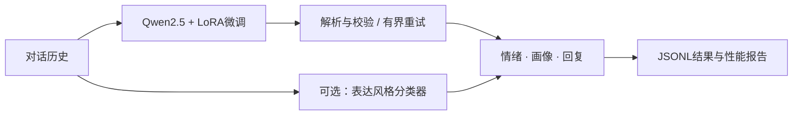

# EmotionCompanion

**面向中文情感陪伴的对话建模与离线推理工程。**

基于 Qwen2.5-7B 与 QLoRA 微调，融合情绪识别、用户画像推断和共情回复生成。
提供数据处理、模型训练、效果评估及 vLLM 离线推理流程，支持画像辅助分类、
结构化输出校验与异常恢复，面向单卡环境部署。

> 仓库整理自比赛工程，推理代码以已验收的 v2.1 为基础。
> 不包含比赛数据、训练权重、真实对话或服务器凭据；示例数据均为人工编写的虚构样例。
> 默认配置关闭需要额外权重的画像辅助分类器，复现完整版本前请按文档训练并启用。

## 能做什么

- **情绪识别**：预测当前用户消息的16类情绪标签。
- **画像推断**：输出人格、兴趣和表达风格三个维度的标签集合。
- **共情回复**：从截止当前轮的对话历史生成中文回复。
- **可靠输出**：JSON解析、枚举校验、一次受限重试，以及逐条失败记录。
- **可复现实验**：训练日志、输入/输出哈希、对话分组划分和同轮推理计时。



## 快速开始

在仓库根目录执行。训练和模型推理需要自行准备合法获取的模型与数据；
测试和示例评估可以在CPU上运行，无需下载语言模型。

```bash
# 只运行CPU测试
python -m pip install -r requirements-test.txt
python -m unittest discover -s tests -v

# 检查示例输出和本地指标；示例成绩不代表真实模型效果
python dev/evaluate.py examples/predictions.jsonl \
  --gt examples/targets.jsonl --output outputs/example_metrics.json
```

### 本地模型推理

准备Linux、NVIDIA GPU、兼容的PyTorch/CUDA及vLLM环境，将完整合并模型放到
`participant/model/`。模型目录至少应包含模型配置、完整权重分片和tokenizer文件。
仅有LoRA adapter不能直接作为vLLM模型目录。

```bash
python -m pip install -r participant/requirements.txt

# 比赛启动脚本会激活名为conda_env的Conda环境
bash participant/start.sh examples/input.jsonl outputs/demo
```

`start.sh`会启动本地vLLM、等待就绪、处理全部输入，然后退出服务。默认使用
`127.0.0.1:8000`，无外部API调用。已有服务或其他环境的使用方法见
[推理与部署](docs/inference.md)。

输出包括：

| 文件 | 用途 |
| --- | --- |
| `submission.jsonl` | 与输入ID一一对应的情绪、画像、回复结果 |
| `performance_report.json` | 前100条端到端延迟、失败记录与文件哈希 |
| `inference_evidence_*/` | 出现异常时保存的原始输出，仅供本地排查 |

不足100条输入仍正常处理，但性能报告的`complete`为`false`。
模型加载时间不计入逐条延迟，异常重试和画像分类耗时计入。

## 训练流程

```bash
# 安装前确认与已有GPU环境兼容；依赖范围不是完整锁文件
python -m pip install -r dev/requirements-train.txt

# 数据根目录包含train/train_public.jsonl和val/val_public.jsonl
python dev/prepare_data.py --data-root /path/to/dataset

# 示例：单卡QLoRA，完整参数和续训方式见文档
python dev/train_sft.py --model /path/to/Qwen2.5-7B-Instruct \
  --output-dir runs/sft --epochs 1 --grad-accum 8 --lr 0.0001 \
  --dtype bf16 --save-steps 100 --eval-steps 100

python dev/merge_lora.py --base /path/to/Qwen2.5-7B-Instruct \
  --adapter runs/sft/adapter --output participant/model --dtype bf16
```

完整说明：[数据格式](docs/data.md) · [训练与续训](docs/training.md) ·
[画像分类器](docs/training.md#画像辅助分类器)

## 历史实验结果

以下为2026年10月17日留存的本地公开数据评估，不是官方隐藏测试成绩。
1802条样本来自721个对话组，与当时552条候选选择集不重叠；
这些数据后来已经被查看，不能继续视为未使用的独立测试集。

| 指标 | v2方案历史结果 |
| --- | ---: |
| 情绪准确率 | 77.58% |
| 画像三维平均精确匹配 | 64.48% |
| 本地BLEU-4 | 13.93 |
| 本地ROUGE-L F1 | 29.10 |
| 空回复 / 最终解析失败 | 0 / 0 |
| 首100条平均延迟 | 3.03秒 |

v2.1保留同一模型与风格分类器，修复批处理失败和结果目录复用行为；
另有135条离线入口验收通过，首100条平均延迟2.54秒。
两组计时使用不同输入，不能据此宣称提速。默认纯生成配置不等同于历史画像混合方案。

另一次400步续训提高了筛选集的情绪和回复指标，但画像退化且存在1条最终解析失败，
没有替换已验收模型。详细对照与限制见[实验结果](docs/experiments.md)。

## 仓库结构

```text
emotion-companion/
├── participant/       # 推理入口、JSON处理、可选画像分类器
│   └── configs/       # 纯生成默认配置与style辅助分类示例
├── dev/               # 数据转换、QLoRA、合并、CPU基线及评估
├── scripts/           # 部署文件静态检查
├── tests/             # CPU单元测试与本地模拟服务集成测试
├── examples/          # 虚构输入、目标与预测格式样例
├── docs/              # 数据、训练、推理及实验说明
└── results/           # 脱敏后的历史汇总指标
```

## 使用边界

本项目是研究与工程复现代码，未提供生产级服务、账号体系或内容安全系统。
原始数据与模型权重需要遵守各自的使用条款；本仓库未授予这些第三方资产的分发权。
代码来源与许可说明见[NOTICE](NOTICE.md)。
